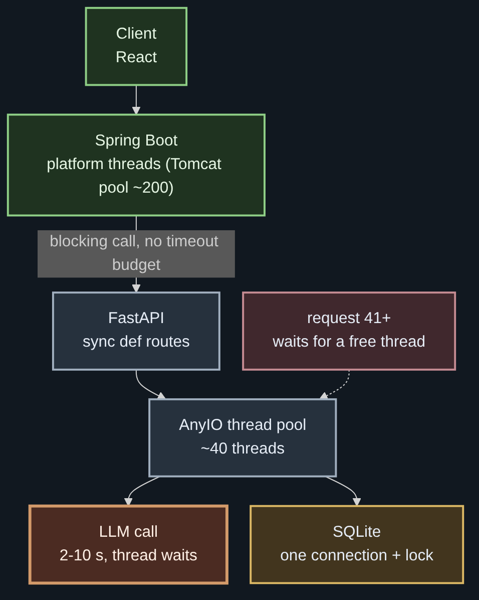
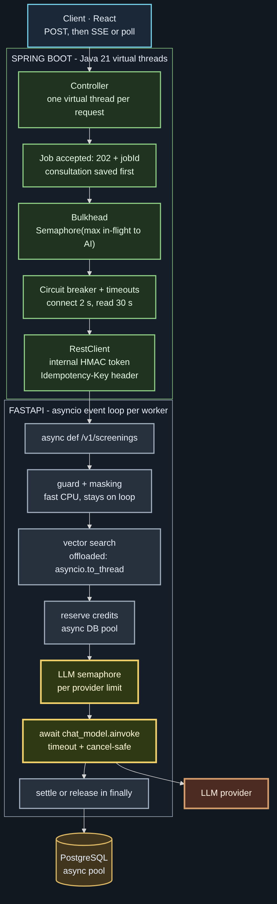
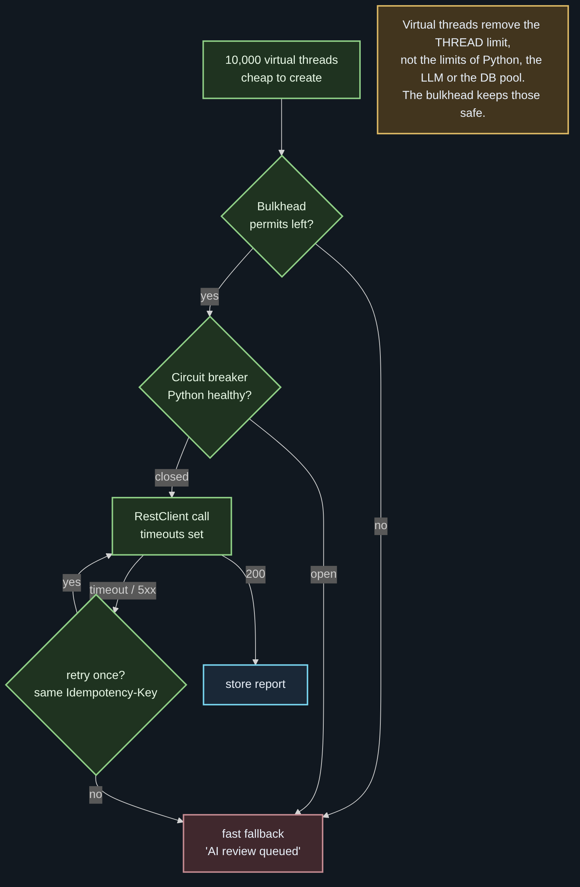
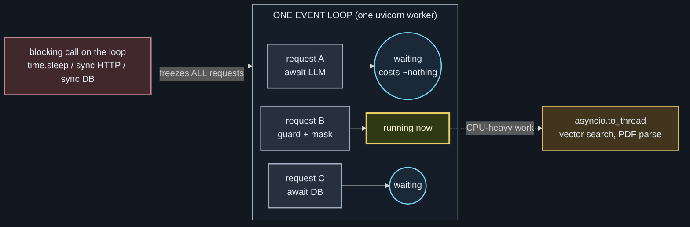
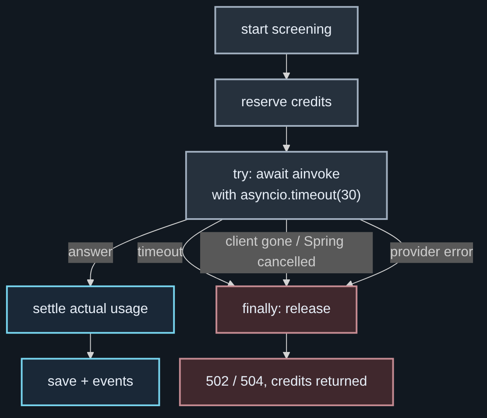
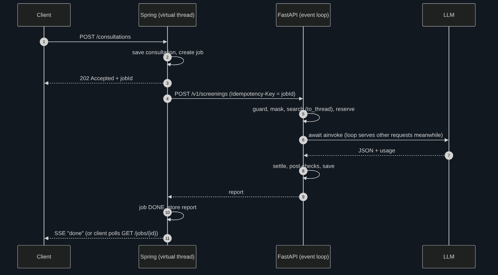
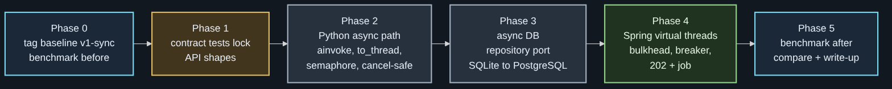
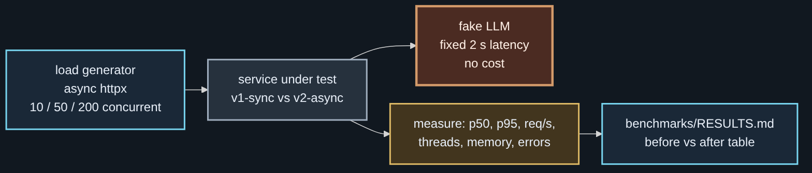

# Async Refactor: Spring Boot Virtual Threads + FastAPI asyncio

> Design for refactoring the legal intake service from a blocking, thread-per-request design (`v1-sync`) to
> **Java 21 virtual threads on the Spring side** and **asyncio on the Python side**.
> Goal: carry more concurrent consultations on the same hardware, keep latency stable under load, and never lose credits or
> data when something slow or broken sits in the middle. Speed of delivery is not the goal; doing it correctly and measuring it is.
>
> The original implementation is preserved as the git tag **`v1-sync`** and stays runnable for side-by-side benchmarks.
>
> This repository holds the design, the study notes and the phase specs. The code changes happen in
> [legal-intake-rag-service](https://github.com/ai-agent-orchestrator/legal-intake-rag-service) (Python) and in a separate Spring
> repository (phase 4). Each phase is implemented by a coding agent under
> [NightCoder](https://github.com/ai-agent-orchestrator/nightcoder) and reviewed before merge.

## Why this refactor

One consultation spends almost all of its time **waiting**: on the LLM (2–10 s), on the database, on the network.
In `v1-sync`, every one of those waits holds an operating-system thread.

| Where | v1-sync today | Limit it creates |
| --- | --- | --- |
| Spring | platform threads (Tomcat pool, ~200); virtual threads not verified yet | the 201st slow request queues |
| FastAPI | plain `def` routes run in the AnyIO thread pool (~40) | the 41st request waiting on the LLM queues, even though the CPU is idle |
| Database | one SQLite connection behind a lock | all writes are serialized |
| LLM | sync `invoke` | a thread is parked for the whole LLM round trip |

What `v1-sync` already does right, and keeps doing: rate limiting **before** the guard and the LLM (floods cost nothing),
cheap checks first, **exactly one** LLM call per request, credits reserved before and released on failure.
The refactor keeps every one of these rules; it changes **how waiting is done**, not what the service does.

## Target design

### Spring Boot (Java 21)

| Change | Why |
| --- | --- |
| `spring.threads.virtual.enabled=true` | a request that waits costs a few KB instead of a parked OS thread; code stays in the simple blocking style |
| **202 Accepted + job id** for screening | the consultation is saved first; the user is never blocked by the AI step; results arrive by SSE or polling |
| **Bulkhead** (`Semaphore`, e.g. 32 permits) around calls to Python | virtual threads remove the *thread* limit, not the limits of Python, the LLM provider or the DB pool |
| **Timeouts** (connect 2 s, read 30 s) and a **circuit breaker** | a slow Python service degrades to "AI review queued" instead of piling up requests |
| **Idempotency-Key** = job id on every call | a retry after a timeout never runs (or bills) the screening twice |
| No `synchronized` around I/O | on JDK 21 it pins the virtual thread to its carrier; use `ReentrantLock` |

### FastAPI (Python asyncio)

| Change | Why |
| --- | --- |
| `async def` for I/O-bound routes | one event loop serves many requests while each one awaits |
| `await chat_model.ainvoke(...)` | the LLM wait no longer holds a thread |
| `asyncio.to_thread(...)` for CPU-heavy or sync-only work (vector search, parsing) | never block the loop: one blocking call freezes every request on that worker |
| **LLM semaphore** per provider | respects provider rate limits; turns overload into a short wait instead of a storm of 429s |
| `asyncio.timeout(...)` + **`finally: release()`** | timeouts, provider errors and client cancellation all return the reserved credits |
| async DB pool behind the existing repository interface | SQLite in development, PostgreSQL (asyncpg) in production; route code does not change |
| Shared clients created once in the app **lifespan** | connection reuse instead of a new TLS handshake per request |

### One request, end to end

## Plan: refactor in phases, measure before and after

| Phase | Work | Done when |
| --- | --- | --- |
| 0 | Tag `v1-sync`; add the benchmark harness with a fake LLM of fixed 2 s latency; record baseline | `benchmarks/RESULTS.md` has the v1 row |
| 1 | Contract tests lock API shapes, status codes, error codes, events and billing ledger entries | the same tests pass on v1 and v2 |
| 2 | Python async path: `ainvoke`, `to_thread`, semaphore, timeouts, cancel-safe billing | all tests pass; no blocking call on the loop (checked by a test) |
| 3 | Async repository port; PostgreSQL adapter (SQLite stays for tests) | storage tests pass on both adapters |
| 4 | Spring: virtual threads, bulkhead, breaker, timeouts, 202 + job, Idempotency-Key | Spring integration tests against a stub Python service |
| 5 | Benchmark again at 10 / 50 / 200 concurrent; write up the numbers and the trade-offs | `RESULTS.md` has v1 vs v2 with p50, p95, req/s, memory, errors |

## Trade-offs to keep in mind

- **Async is contagious.** Every call on the request path must be awaitable or explicitly offloaded; one hidden sync call
  (a library doing blocking I/O) cancels the benefit. A test fails if a known blocking call runs on the loop.
- **More concurrency is not more capacity downstream.** The LLM provider and the database still have limits; the semaphores and
  the bulkhead are what keep the system stable.
- **202 + job changes the client.** The front end must show "AI review in progress" and listen for the result.
- **Measure, do not assume.** The fake-LLM benchmark isolates the effect of the refactor from provider latency and cost.

## Status

| Phase | State |
| --- | --- |
| 0 · baseline benchmark | queued (overnight run) |
| 1 · contract tests | queued |
| 2 · async Python | queued |
| 3 · async DB port | queued |
| 4 · Spring | later, separate repository |
| 5 · benchmark after | queued after 2 and 3 |

Numbers are added to this README only after they are measured.

## Files

| Path | What |
| --- | --- |
| `README.md` | this design |
| `STUDY_ko.md` | study notes in Korean: threads, event loop, virtual threads, cancel safety, with 12 diagrams |
| `SPECS.md`, `specs/` | one spec per phase, as handed to the coding agent |
| `diagrams/` | Mermaid sources (`.mmd`) and rendered `.svg` / `.png`, same dark theme as the orchestration repository |
