# 비동기 리팩토링 교과서 (초보자용)

> 코딩 초보를 위한 설명서. 내 법률 상담 서비스를 "기다리는 동안 자리를 비우는" 구조로 바꾸는 과정을 식당 비유와 그림으로 따라갑니다.
> 설계 문서(영문): [README.md](README.md)

## 1장 · 서버는 대부분의 시간을 "기다리며" 보낸다

상담 요청 하나를 처리하는 시간 대부분은 계산이 아니라 기다림입니다. LLM이 답을 만드는 2–10초 동안 서버는 사실상 아무것도 안 합니다. 리팩토링의 핵심 질문은 "그 기다리는 시간 동안 무엇을 붙잡고 있느냐"입니다.

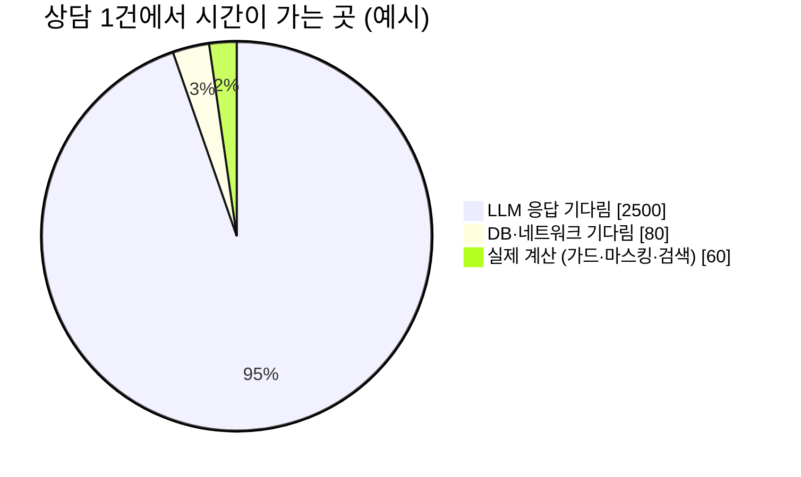

> **확인 문제** CPU를 더 빠른 것으로 바꾸면 상담 처리량이 크게 늘까요?
>
> <details><summary>답 보기</summary>거의 늘지 않습니다. 시간 대부분이 계산이 아니라 기다림이기 때문입니다. 기다리는 방법을 바꿔야 합니다.</details>

## 2장 · 스레드 = 웨이터, 지금은 웨이터가 테이블 옆에 서서 기다린다

지금 Python 서버는 웨이터(스레드)가 약 40명입니다. 웨이터는 주문(LLM 호출)을 넣고 요리가 나올 때까지 그 테이블 옆에 서 있습니다. 41번째 손님은 홀이 비어 있어도 기다려야 합니다.

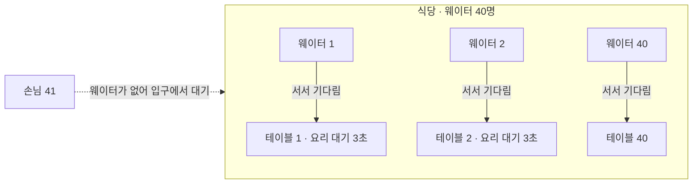

**지금 코드 (일반 def)**

```python
@router.post("/screenings")
def create_screening(situation, ctx, s):
    r = s.screening.run(...)   # 안에서 LLM invoke
    return {...}               # 끝날 때까지 스레드 점유
```

**FastAPI가 하는 일**

```python
# def 함수는 스레드 풀(약 40개)에서 실행
# → 동시 처리 한도 ≈ 스레드 수
```

## 3장 · 비동기(async/await) = 주문 넣고 다른 테이블로 가는 웨이터

`await`는 "여기서 기다릴 테니, 그동안 다른 일을 해도 돼"라는 표시입니다. 웨이터 한 명(이벤트 루프)이 수십 테이블을 동시에 맡을 수 있습니다.

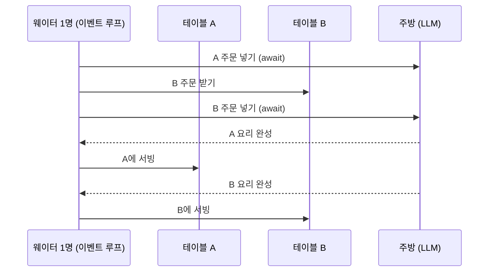

**바꾼 코드 (async def)**

```python
@router.post("/screenings")
async def create_screening(situation, ctx, s):
    r = await s.screening.arun(...)
    return {...}
```

**LLM 호출도 바꿔야 효과**

```python
# 전: msg = chat_model.invoke(messages)
msg = await chat_model.ainvoke(messages)
```

> **확인 문제** 함수만 `async def`로 바꾸고 안에서 여전히 `invoke`(동기)를 부르면 어떻게 될까요?
>
> <details><summary>답 보기</summary>더 나빠집니다. async 함수는 이벤트 루프 위에서 돌기 때문에, 안의 동기 호출이 루프 전체를 멈춰 세웁니다. 그 웨이터가 맡은 모든 손님이 같이 기다리게 됩니다(7장).</details>

## 4장 · 가상 스레드(Java 21) = 기다리는 동안 투명해지는 웨이터

Java의 가상 스레드는 코드를 "서서 기다리는" 쉬운 모양 그대로 두는데, Java가 기다리는 순간을 알아채고 실제 일꾼(캐리어 스레드)을 다른 요청에 빌려줍니다. 비동기의 효과를 코드 변경 거의 없이 얻는 방법입니다.

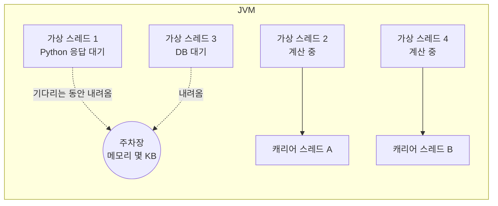

**application.yml**

```
spring:
  threads:
    virtual:
      enabled: true
```

**주의 (JDK 21)**

```
// synchronized 안에서 I/O를 하면
// 가상 스레드가 캐리어에 "고정(pinning)"됨
// → ReentrantLock 사용
```

<table>
      <thead><tr><th></th><th>Python async/await</th><th>Java 가상 스레드</th></tr></thead>
      <tbody>
        <tr><td>코드 모양</td><td>바뀜 (<code>async</code>, <code>await</code> 표시)</td><td>거의 그대로 (동기 코드)</td></tr>
        <tr><td>기다림 처리</td><td>개발자가 <code>await</code>로 표시</td><td>JVM이 자동으로 알아챔</td></tr>
        <tr><td>실수하면</td><td>동기 호출 하나가 루프 전체를 멈춤</td><td>synchronized + I/O면 효과가 사라짐</td></tr>
      </tbody>
    </table>

## 5장 · 지금 구조 (v1-sync): 어디서 막히나

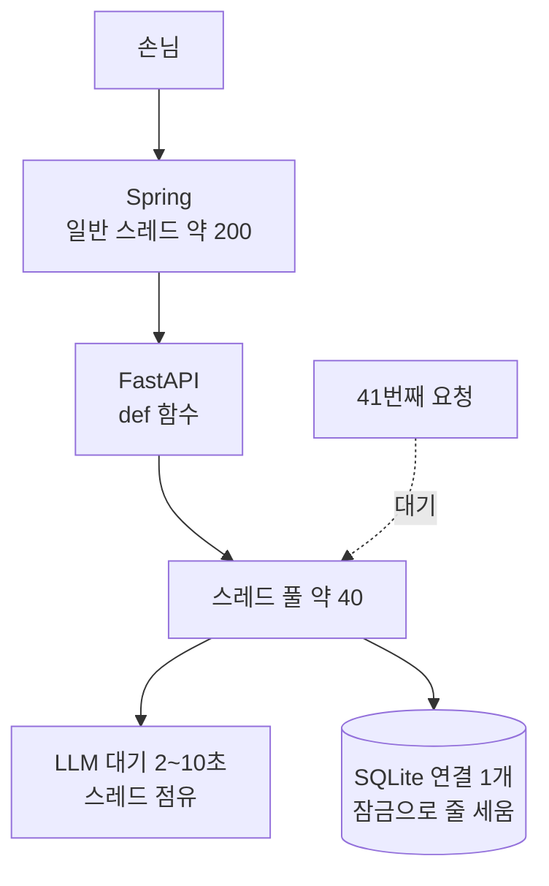

그래도 지금 설계에서 잘한 점은 그대로 지킵니다: 속도 제한을 맨 앞에, 싼 검사를 먼저, LLM은 정확히 1번, 실패하면 크레딧 돌려주기.

## 6장 · 새 구조 (v2-async): 한 장으로 보기

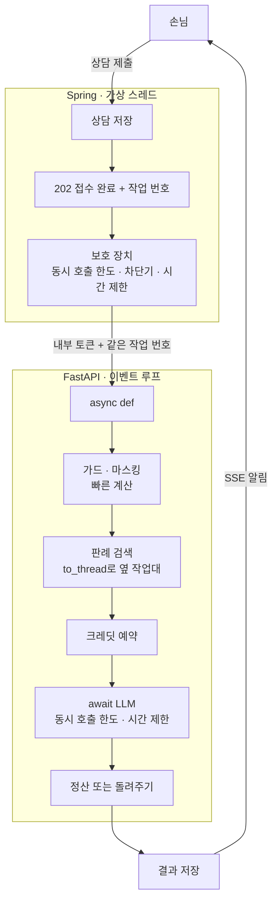

## 7장 · 이벤트 루프에서 절대 하면 안 되는 것: 막는 호출

웨이터가 한 명뿐이라, 그 웨이터가 한 테이블에서 멍하니 서 있으면 식당 전체가 멈춥니다. 오래 걸리는 계산은 "옆 작업대"(`asyncio.to_thread`)로 보냅니다.

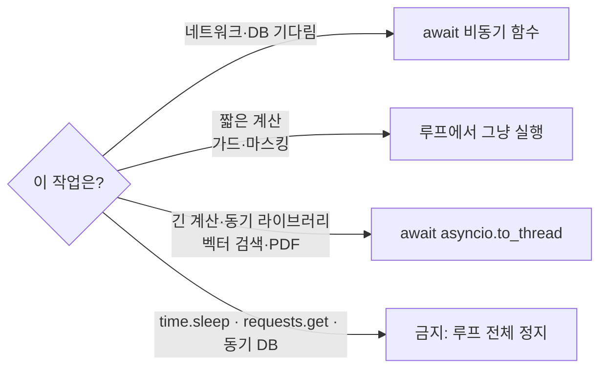

**나쁜 예**

```python
async def search(q):
    return store.search(q)   # 동기 + 무거움
                             # → 루프 정지
```

**좋은 예**

```python
async def search(q):
    return await asyncio.to_thread(store.search, q)
```

## 8장 · 돈을 잃지 않는 법: 취소돼도 크레딧은 돌려준다

비동기에서는 요청이 중간에 "취소"될 수 있습니다(시간 초과, 손님이 나감). 그래서 크레딧 돌려주기를 `finally`에 둡니다. 어떤 길로 끝나도 반드시 실행되는 자리입니다.

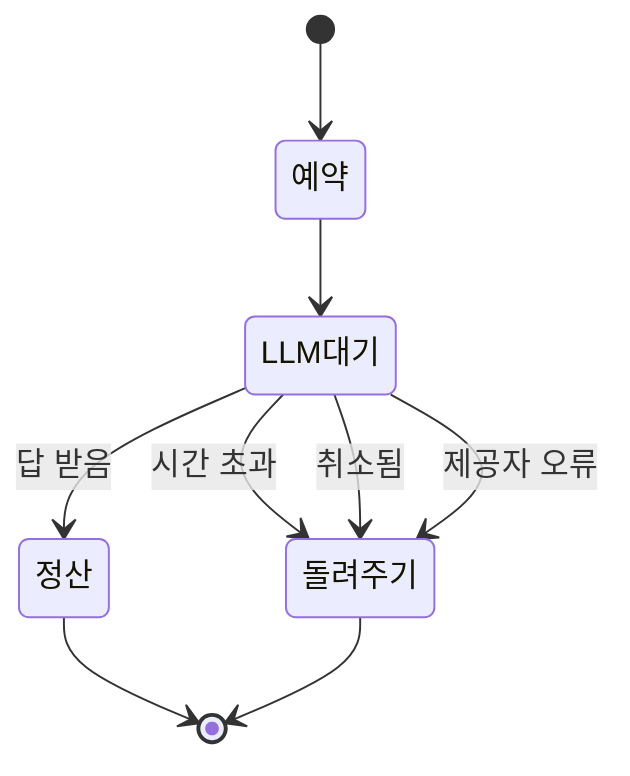

```python
rid = await wallet.reserve(tenant, 1)
settled = False
try:
    async with asyncio.timeout(30):
        msg = await chat_model.ainvoke(messages)
    await wallet.settle(tenant, rid, credits, usd)
    settled = True
finally:
    if not settled:
        await wallet.release(tenant, rid)   # 취소·오류·시간 초과 모두 여기로
```

## 9장 · 가상 스레드만으로는 부족한 이유: 보호 장치

가상 스레드는 Spring의 "웨이터 수 한도"만 없앱니다. 주방(LLM)과 창고(DB)의 크기는 그대로입니다. 그래서 문 앞에 "동시에 주방에 넣는 주문 수"를 제한하는 장치(벌크헤드)를 둡니다.

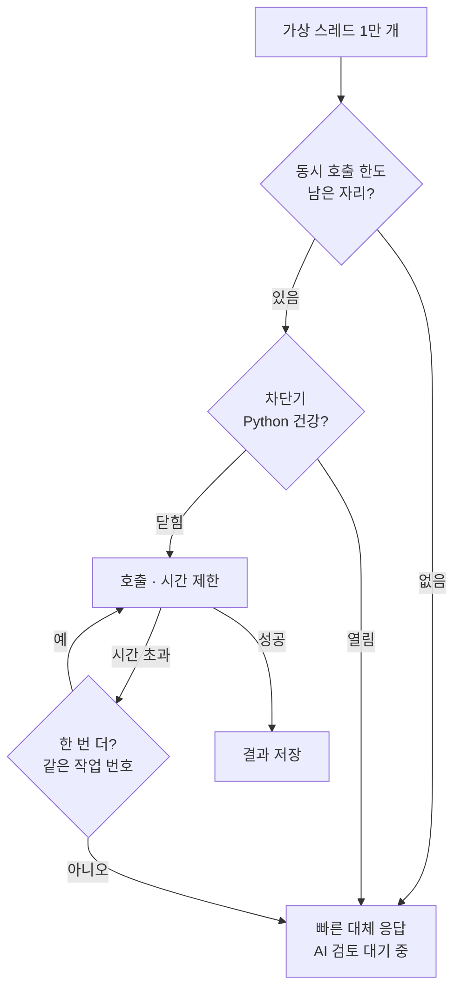

"같은 작업 번호(Idempotency-Key)"로 다시 보내면, Python은 이미 처리한 요청인지 알아보고 두 번 실행(두 번 과금)하지 않습니다.

## 10장 · 202와 작업 번호: 손님을 기다리게 하지 않는 법

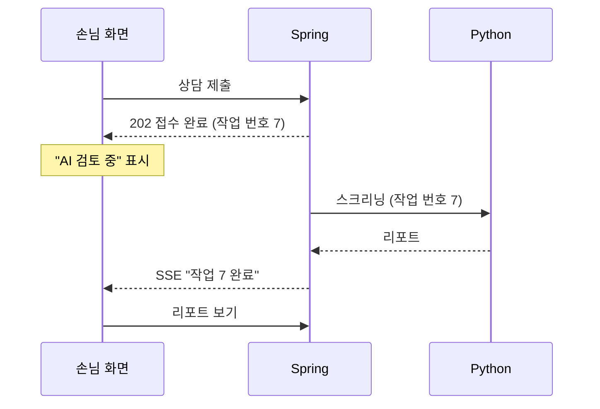

## 11장 · 리팩토링 단계: 한 번에 바꾸지 않는다


> 각 단계가 끝날 때마다 전체 테스트가 통과해야 다음으로 갑니다. 원본(v1-sync)은 언제든 다시 실행해서 비교할 수 있게 남겨 둡니다.

## 12장 · 정말 빨라졌는지 재는 법

진짜 LLM으로 재면 돈도 들고, LLM 속도에 따라 결과가 흔들립니다. 그래서 "항상 2초 걸리는 가짜 LLM"을 두고, 같은 조건에서 v1과 v2를 비교합니다.

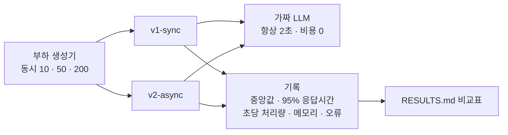

> **확인 문제** 동시 200명일 때 v1의 95% 응답시간이 크게 늘어나는 이유는?
>
> <details><summary>답 보기</summary>스레드 40개가 모두 LLM을 기다리며 잡혀 있어서, 나머지 요청은 줄을 서기 때문입니다. 2초짜리 작업이 줄 선 시간만큼 길어집니다.</details>

## 13장 · 용어 정리

<table>
      <thead><tr><th>용어</th><th>쉬운 뜻</th><th>이 프로젝트에서</th></tr></thead>
      <tbody>
        <tr><td>스레드</td><td>일을 처리하는 웨이터</td><td>지금 Python은 약 40명</td></tr>
        <tr><td>이벤트 루프</td><td>여러 테이블을 오가는 웨이터 한 명</td><td>uvicorn 작업자마다 1개</td></tr>
        <tr><td>await</td><td>"여기서 기다릴게, 그동안 딴 일 해"</td><td>LLM·DB·HTTP 호출 앞</td></tr>
        <tr><td>to_thread</td><td>무거운 일을 옆 작업대로</td><td>벡터 검색</td></tr>
        <tr><td>가상 스레드</td><td>기다리면 투명해지는 웨이터</td><td>Spring 요청 처리</td></tr>
        <tr><td>세마포어 · 벌크헤드</td><td>동시에 들어갈 수 있는 인원 제한</td><td>LLM 동시 호출, Spring→Python 호출</td></tr>
        <tr><td>서킷 브레이커</td><td>고장 난 곳으로 계속 보내지 않는 차단기</td><td>Python이 느리면 대체 응답</td></tr>
        <tr><td>Idempotency-Key</td><td>같은 주문 번호면 한 번만 처리</td><td>재시도해도 두 번 과금 없음</td></tr>
        <tr><td>p95</td><td>100명 중 95번째로 느린 사람의 대기 시간</td><td>측정표의 핵심 숫자</td></tr>
      </tbody>
    </table>
